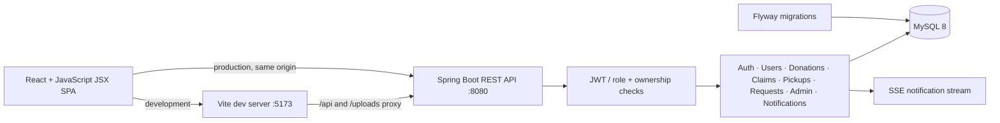

# FoodBridge

**FoodBridge** is a full-stack food donation and NGO coordination platform. Food businesses can list surplus food, and verified NGOs can discover and claim suitable donations, coordinate pickups, and record completed handovers.

> **Food safety:** FoodBridge is a coordination tool, not a food-safety certifier. Donors are responsible for accurate preparation, storage, allergen, and expiry information. NGOs must independently assess food suitability before accepting or collecting it.

## Contents

- [Features](#features)
- [Technology](#technology)
- [Architecture](#architecture)
- [Repository structure](#repository-structure)
- [Prerequisites](#prerequisites)
- [Quick start on Windows 11](#quick-start-on-windows-11)
- [Run frontend and backend separately](#run-frontend-and-backend-separately)
- [Build a single backend JAR with the UI](#build-a-single-backend-jar-with-the-ui)
- [Configuration](#configuration)
- [Demo accounts](#demo-accounts)
- [API and database](#api-and-database)
- [Tests and quality checks](#tests-and-quality-checks)
- [Troubleshooting](#troubleshooting)
- [Security notes](#security-notes)
- [Known limitations](#known-limitations)

## Features

### Donor

- Register, sign in, manage a profile, and review dashboard/activity information.
- Create, update, browse, and cancel available donations.
- Provide food category, quantity/unit, food type, preparation and expiry times, pickup details, storage information, allergens, handling instructions, and a safety declaration.
- Review claims and coordinate pickup/handover.

### NGO

- Register for an NGO account; accounts must be approved by an administrator before claiming donations.
- Browse and filter available donations, view details, and submit a claim with a suitability acknowledgement.
- Manage claims, pickup schedules, confirmations, and food requests.
- Review notifications and impact/history information.

### Admin

- Review platform statistics, users, NGOs, donations, claims, categories, reports, activity, and audit records.
- Approve or reject NGO verification applications and activate/deactivate accounts.

### Shared capabilities

- Role-based API authorization and ownership checks on the server.
- JWT access tokens, rotating refresh tokens in an HttpOnly cookie, and BCrypt password hashing.
- Persistent in-app notification history plus server-sent events (SSE) for connected clients.
- Atomic donation claiming: a donation can have at most one active claim; competing claims cannot both succeed.
- Two-party pickup confirmation; completion is recorded only after donor handover and NGO collection confirmation.
- Donation expiry checks, impact logging, API validation, and a consistent API error response format.

## Technology

Versions below are the versions pinned/configured in this project (or the project baseline). Use the committed lockfile for the frontend.

| Area | Technology |
|---|---|
| Backend | Java 21, Spring Boot 3.5.16, Spring Web, Spring Security, Spring Data JPA/Hibernate, Bean Validation, Actuator |
| Authentication | JJWT 0.12.6, BCrypt |
| Database/migrations | MySQL 8 target, MySQL Connector/J, Flyway |
| API docs | Springdoc OpenAPI 2.8.17 / Swagger UI |
| Backend build | Maven; JUnit 5, Mockito, Spring test and MockMvc/HTTP integration tests |
| Frontend | JavaScript (ES2022) + JSX, React 18.3.1, Vite 5.4.21, React Router 6.28.1 |
| Frontend forms/network/UI | Axios 1.7.9, React Hook Form 7.54.2, Zod 3.24.1, Lucide React 0.468.0, Tailwind CSS 3.4.17 |
| Frontend tests/quality | Vitest 2.1.8, React Testing Library, MSW 2.7.0, ESLint 9.17.0 |

## Architecture

FoodBridge is a **modular monolith**. Each backend business area has its own package and communicates through services. The React SPA is served by Vite during development and is also bundled under the backend's `static` resources for a single-origin deployment.



Core claim/pickup flow:

```text
Donation AVAILABLE -> CLAIMED -> COMPLETED
          |                |
          v                v
       CANCELLED     claim/pickup cancellation (eligible states only)
          |
          +-- expiry sweep -> EXPIRED

Pickup completion requires donor handover confirmation AND NGO collection confirmation.
```

## Repository structure

```text
FoodBridge/
├── README.md
├── IMPLEMENTATION_STATUS.md
├── backend/
│   ├── pom.xml
│   └── src/
│       ├── main/
│       │   ├── java/com/foodbridge/
│       │   │   ├── admin/          # platform administration, reports, audit
│       │   │   ├── auth/           # registration, login, refresh, password flows
│       │   │   ├── claim/          # claims and atomic claim rules
│       │   │   ├── common/         # shared paging, API response helpers
│       │   │   ├── config/         # application, seeding, web and OpenAPI config
│       │   │   ├── donation/       # donations, categories, images, expiry
│       │   │   ├── exception/      # global API error handling
│       │   │   ├── impact/         # completed donation impact records
│       │   │   ├── notification/   # persistent notifications and SSE
│       │   │   ├── pickup/         # pickup scheduling and confirmations
│       │   │   ├── request/        # NGO food requests
│       │   │   ├── security/       # JWT filter and authenticated principal
│       │   │   └── user/           # users and donor/NGO profiles
│       │   └── resources/
│       │       ├── application.yml
│       │       ├── application-dev.yml
│       │       ├── application-prod.yml
│       │       ├── db/migration/   # Flyway V1 schema and V2 category seed
│       │       └── static/         # built SPA assets served by Spring
│       └── test/
│           ├── java/com/foodbridge/ # unit and integration tests
│           └── resources/          # test profile configuration
├── frontend/
│   ├── package.json
│   ├── package-lock.json
│   ├── vite.config.js
│   └── src/
│       ├── api/                    # API client, endpoint functions, types
│       ├── auth/                   # auth context and protected routes
│       ├── components/             # reusable UI, forms, tables, notifications
│       ├── hooks/                  # reusable data hooks
│       ├── layouts/                # public, donor, NGO and admin shells
│       ├── lib/                    # shared utilities/validation
│       ├── pages/                  # public, donor, NGO, shared and admin routes
│       └── test/                   # Vitest, RTL and MSW tests
└── scripts/
    └── smoke-test.sh               # API smoke checks (mutates dev data)
```

## Prerequisites

- **JDK 21** (the Maven compiler targets Java 21).
- **Maven 3.9+**.
- **Node.js 20+** and npm.
- **MySQL 8.0+** for the intended database target. The app uses MySQL-compatible JDBC and Flyway migrations.
- Git is recommended for source control.

The backend is also verified in this workspace with MariaDB 11.8.6. MySQL 8 is the intended target; see the MySQL migration note in [Troubleshooting](#troubleshooting).

## Quick start on Windows 11

Use one PowerShell window for the backend and a second for the frontend. From the project root:

```powershell
$root = "C:\path\to\FoodBridge"
```

### 1. Create the databases and local user

Start the MySQL service (commonly named `MySQL80`; an administrator PowerShell may be required):

```powershell
Get-Service *mysql*
Start-Service MySQL80
```

In MySQL Workbench or the MySQL command-line client, run:

```sql
CREATE DATABASE IF NOT EXISTS foodbridge
  CHARACTER SET utf8mb4 COLLATE utf8mb4_unicode_ci;
CREATE DATABASE IF NOT EXISTS foodbridge_test
  CHARACTER SET utf8mb4 COLLATE utf8mb4_unicode_ci;

CREATE USER IF NOT EXISTS 'foodbridge'@'localhost' IDENTIFIED BY 'foodbridge';
GRANT ALL PRIVILEGES ON foodbridge.* TO 'foodbridge'@'localhost';
GRANT ALL PRIVILEGES ON foodbridge_test.* TO 'foodbridge'@'localhost';
FLUSH PRIVILEGES;
```

These credentials are for **local development only**. Use a separate database account and secret in production.

### 2. Start the backend

```powershell
cd "$root\backend"

$env:DB_URL = "jdbc:mysql://127.0.0.1:3306/foodbridge?useSSL=false&allowPublicKeyRetrieval=true&serverTimezone=UTC&characterEncoding=utf8"
$env:DB_USERNAME = "foodbridge"
$env:DB_PASSWORD = "foodbridge"

mvn spring-boot:run
```

Flyway applies the database migrations on startup. Keep this terminal open. The API listens on **http://localhost:8080**.

> If your IDE sets `DB_URL` or `SPRING_DATASOURCE_URL`, make sure it is a JDBC URL beginning with `jdbc:mysql://`. Spring's `url must start with jdbc` error indicates an invalid URL override.

### 3. Start the frontend

In a second PowerShell window:

```powershell
cd "$root\frontend"
npm ci
npm ls vite
npm run dev
```

The installed Vite should be **5.4.21**. Open **http://localhost:5173**. The Vite config proxies `/api` and `/uploads` requests to the backend at `http://localhost:8080`.

If `npm run dev` says it cannot find `/src/main.jsx`, first check that `frontend\src\main.jsx` exists and that PowerShell is in the `frontend` directory containing the project's `package.json`. Reinstalling npm packages does not restore missing source files.

### Useful URLs

| URL | Purpose |
|---|---|
| `http://localhost:5173` | Frontend development server |
| `http://localhost:8080/actuator/health` | Backend health |
| `http://localhost:8080/api-docs` | OpenAPI JSON |
| `http://localhost:8080/swagger-ui.html` | Swagger UI (redirects to UI path) |
| `http://localhost:8080/api/public/stats` | Public platform counters |

## Run frontend and backend separately

The quick start above is the normal development mode. Run backend and frontend in separate terminals so Vite provides fast reloads and the backend serves API requests.

### Backend tests and run

```powershell
cd "$root\backend"
mvn verify
mvn spring-boot:run
```

`mvn verify` executes unit tests and integration tests. Integration tests use the `foodbridge_test` database by default; configure `TEST_DB_URL`, `TEST_DB_USERNAME`, and `TEST_DB_PASSWORD` if needed.

### Frontend checks and run

```powershell
cd "$root\frontend"
npm ci
npm run lint
npm test
npm run build
npm run dev
```

## Build a single backend JAR with the UI

The checked-in `backend/src/main/resources/static/` directory contains the bundled SPA used for the single-origin mode. To refresh those assets after changing frontend code:

```powershell
cd "$root\frontend"
npm ci
npm run build

Remove-Item -Recurse -Force ..\backend\src\main\resources\static\* -ErrorAction SilentlyContinue
Copy-Item -Path .\dist\* -Destination ..\backend\src\main\resources\static\ -Recurse -Force

cd ..\backend
mvn clean verify
java -jar .\target\foodbridge-backend-1.0.0.jar
```

The combined application is then served at **http://localhost:8080**. Do not rebuild/replace a JAR while that same JAR is running; stop the application first, then restart the newly built artifact.

## Configuration

`backend/src/main/resources/application.yml` contains development defaults. Environment variables override them.

| Variable | Default | Description |
|---|---|---|
| `SERVER_PORT` | `8080` | Backend HTTP port |
| `DB_URL` | `jdbc:mysql://localhost:3306/foodbridge?...` | JDBC URL for the app database |
| `DB_USERNAME` / `DB_PASSWORD` | `foodbridge` / `foodbridge` | Local DB credentials |
| `DB_POOL_SIZE` | `10` | Hikari connection pool size |
| `JWT_SECRET` | Development-only key in config | JWT signing secret; replace with a strong secret outside local development |
| `CORS_ALLOWED_ORIGINS` | localhost dev origins | Explicit CORS origins |
| `CORS_ALLOWED_ORIGIN_PATTERNS` | local and preview patterns | Allowed origin patterns; restrict in production |
| `COOKIE_SECURE` | `false` | Set `true` behind HTTPS in production |
| `COOKIE_SAME_SITE` | `Lax` | Refresh-cookie SameSite setting |
| `FB_FRAME_OPTIONS` | `SAMEORIGIN` | Frame policy; do not disable in production without a clear need |
| `EXPOSE_RESET_TOKEN` | `true` in local config | Local reset-flow convenience; production profile disables exposure |
| `UPLOAD_DIR` | `./uploads` | Donation-image storage directory |
| `SEED_DEMO_DATA` | `true` | Seeds demo records when the DB has no users |
| `LOG_LEVEL` | `INFO` | `com.foodbridge` log level |
| `TEST_DB_URL` | `jdbc:mysql://localhost:3306/foodbridge_test?...` | Database used by integration tests |
| `TEST_DB_USERNAME` / `TEST_DB_PASSWORD` | `foodbridge` / `foodbridge` | Test database credentials |

Never commit real credentials or production JWT secrets. The `prod` profile disables demo seeding and reset-token exposure and expects production-grade secrets, HTTPS, and restricted CORS settings.

## Demo accounts

With the default seed enabled, these local demo accounts are available after seeding:

| Role | Email | Password |
|---|---|---|
| Admin | `admin@foodbridge.dev` | `Admin@12345` |
| Donor | `donor@foodbridge.dev` | `Donor@12345` |
| Donor | `hotel@foodbridge.dev` | `Hotel@12345` |
| Donor | `bakery@foodbridge.dev` | `Bakery@12345` |
| Verified NGO | `ngo@foodbridge.dev` | `Ngo@12345` |
| Verified NGO | `ngo2@foodbridge.dev` | `Ngo2@12345` |
| Pending NGO | `ngo.pending@foodbridge.dev` | `Ngo@12345` |

These are demo credentials only. Change or remove them before any non-local deployment.

## API and database

- REST endpoints are under `/api`; request validation and role/ownership checks are enforced server-side.
- OpenAPI JSON is available at `/api-docs`; Swagger UI is available at `/swagger-ui.html`.
- Database schema changes are versioned in `backend/src/main/resources/db/migration/` and applied by Flyway.
- Core tables include users, donor/NGO profiles, donations, categories, donation images, claims, pickups, NGO requests, notifications, impact logs, audit logs, refresh tokens, and one-time tokens.
- Search/filtering and pagination are handled by the backend for the relevant endpoints.
- Notifications are persisted; SSE is a live delivery channel, not the source of history.

## Tests and quality checks

Run from each project directory:

```powershell
# Backend: unit + integration suite
cd "$root\backend"
mvn verify

# Frontend
cd "$root\frontend"
npm test
npm run lint
npm run build
```

The backend suite has previously completed with **58 passing tests**; the frontend suite with **15 passing tests**. Results can vary if local database setup or source files differ from this repository.

`scripts/smoke-test.sh` exercises the running API and **mutates development data**. It is intended for a disposable local environment, not production. Use Git Bash or WSL on Windows:

```bash
bash scripts/smoke-test.sh
```

## Troubleshooting

### Flyway: `Detected failed migration to version 1`

This means a prior attempt to apply V1 failed. MySQL DDL may leave tables behind. Do not run `flyway repair` blindly. For a disposable local database, after resolving the cause, drop and recreate that development schema before retrying. Dropping a database permanently deletes its data.

### Flyway V1: `Cannot add foreign key constraint` at the `claims` table

The failure has been observed on a local MySQL 8 setup around the `claims` table in V1 (the foreign keys are `fk_claims_donation` and `fk_claims_ngo`). The same migration has succeeded in this workspace against MariaDB 11.8.6, but the exact MySQL 8 foreign-key cause has not yet been confirmed. Capture the actual schema/server details before retrying:

```sql
SELECT DATABASE(), VERSION();
SHOW CREATE TABLE foodbridge_dev.users;
SHOW CREATE TABLE foodbridge_dev.donations;
SHOW ENGINE INNODB STATUS;
```

Run the InnoDB status query immediately after reproducing the failure and inspect `LATEST FOREIGN KEY ERROR`. Ensure the output is from the exact schema in `DB_URL`. If the section is absent, capture the full MySQL server error log or run the failing `CREATE TABLE claims` statement manually and query InnoDB status immediately afterward. Avoid `repair` or deleting Flyway history as a substitute for correcting the cause.

### `url must start with jdbc`

Set `DB_URL` to a JDBC URL such as `jdbc:mysql://127.0.0.1:3306/foodbridge?...`. Remove invalid `DB_URL` / `SPRING_DATASOURCE_URL` overrides from the shell or IDE Run Configuration.

### Frontend says `/src/main.jsx` does not exist

Run `Test-Path .\src\main.jsx` from `frontend`. If false, use the complete project source folder; npm install cannot recreate deleted or missing application source.

### Port 8080 is already in use

Stop the other Spring Boot process or set a different `SERVER_PORT`. The frontend dev proxy target must then be updated (for example using `VITE_PROXY_TARGET`).

## Security notes

- Passwords are BCrypt-hashed; plaintext passwords are not stored.
- Access tokens are short-lived; refresh tokens are rotated and stored as hashes server-side, with the browser token in an HttpOnly cookie.
- The API validates ownership and roles on the server; hiding a frontend button is not an authorization control.
- File uploads are limited by configured size/type checks and stored under generated keys.
- The default JWT key, demo users, exposed reset-token convenience, and permissive local CORS settings are for development only. Use secrets management, HTTPS, restricted origins, secure cookies, and production database credentials for deployment.
- FoodBridge does not certify food safety and does not provide real-time delivery tracking.

## Known limitations

- Email delivery for password-reset links is not configured; the local profile exposes a reset token for development/testing. Production email integration must be configured before offering user-facing reset emails.
- The MySQL 8 V1 foreign-key migration failure described above remains under investigation; MariaDB 11.8.6 is the database engine used for verification in this workspace.
- Dockerfiles, Docker Compose, GitHub Actions workflows, and cloud deployment configuration are not currently included in this repository. No deployment is claimed.
- No screenshot assets are committed in this project copy.
